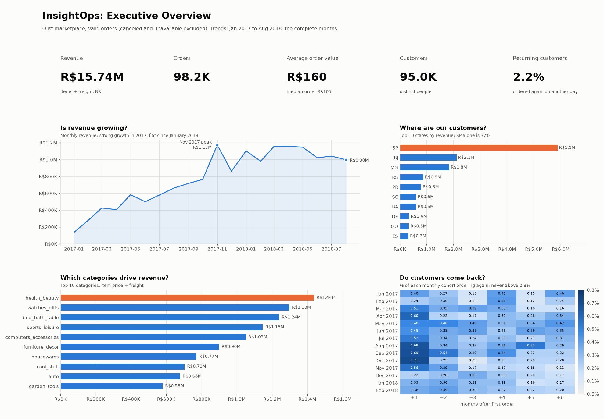
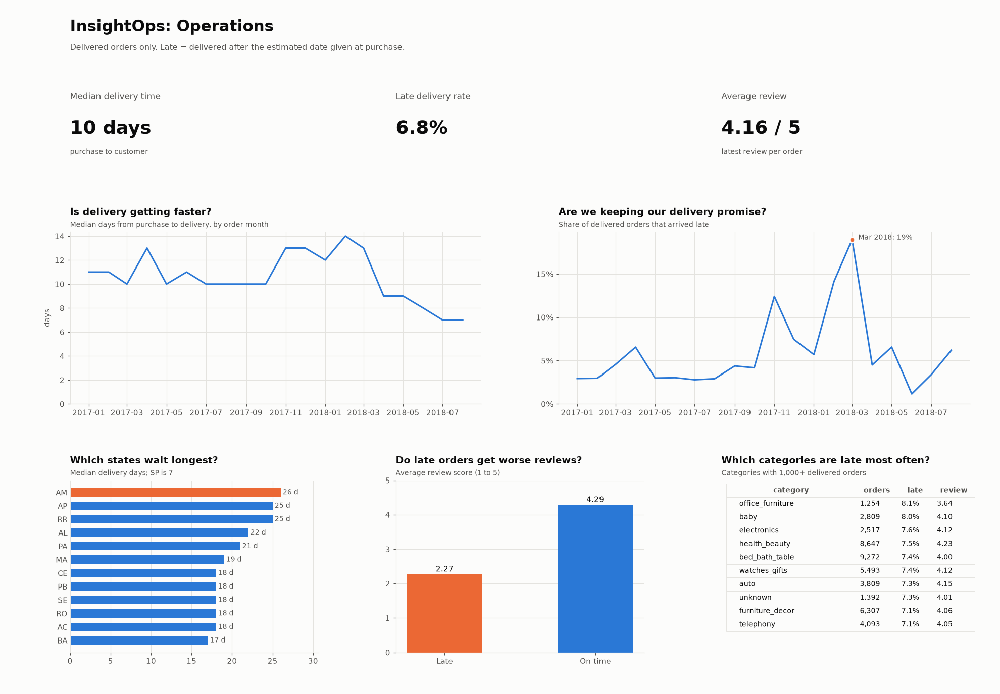
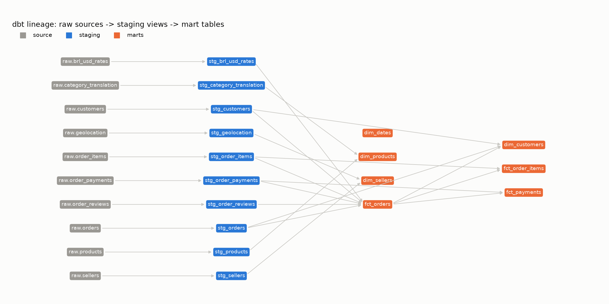

# Dashboards

Both pages are built from the dbt marts by `scripts/build_dashboards.py`, using the
definitions in `docs/metric-catalog.md`. Rebuild them with:

```bash
python scripts/build_dashboards.py
```

## Executive overview



For a busy executive: the five headline numbers, whether revenue is growing, where
customers are, which categories drive revenue, and whether customers come back.
The headline is the retention heatmap: no monthly cohort ever has more than 0.8% of
its customers order again in a later month.

## Operations



For a logistics or seller manager: delivery speed, late rate, reviews, and the states
and categories where the delivery promise breaks. Delivery time and late rate are
separate charts on purpose: they have different units, and a shared chart with two
y-axes would invite false comparisons. Feb-Mar 2018 stands out: deliveries were not
much slower, but the late rate jumped to 19%, so the delivery estimates were too tight.

## Excel report

`category_report.xlsx`, built by `scripts/build_excel_report.py`:
- **pivot**: revenue and orders by category and year, sorted by total revenue, with
  `XLOOKUP` to the targets sheet and actual vs target %, plus a top 10 bar chart.
- **targets**: illustrative revenue targets for 5 categories (made up for the exercise).

The pivot is a computed summary table rather than an Excel PivotTable object, because
the workbook is generated by a script.

## Looker Studio

`scripts/export_marts.py` and `scripts/export_cohort_retention.sql` write the 9 CSVs in
`data/exports/` that a Looker Studio version would use (see the build guide, Phase 5).
A public Looker Studio link isn't published yet.

## dbt lineage



Drawn from `dbt/target/manifest.json` by `scripts/plot_lineage.py`.
